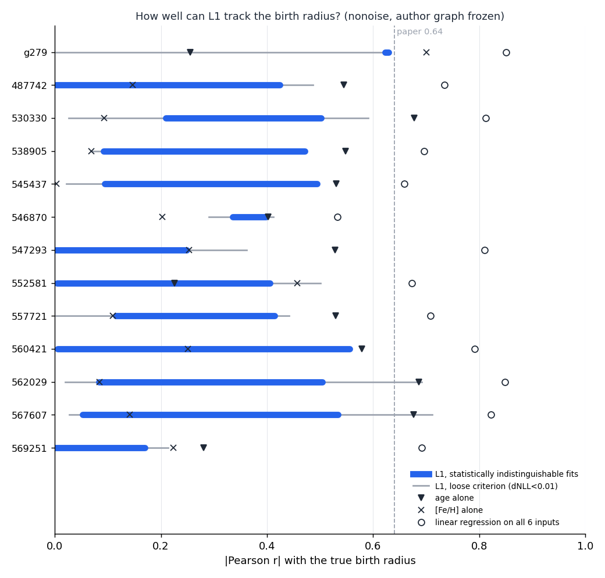

# 用 TNG50 检验"因果发现找出生半径"的方法（RLCD）——项目汇报

- 项目文件夹：`/Volumes/001HardDisk/MW/casuality`（下文所有路径都相对于这个文件夹）
- 日期：2026-09-26（2026-09-27 更新：结构学习 30 个种子的频率；出图脚本；三种放宽的选星条件 0<R<30 kpc、|z| < 30 / 3 / 0.3 kpc 下的做法 A 结果；结论相应补充）
- 配套文档：`docs/pipeline_plan.md`（逐条命令、安装记录、踩过的坑，用来复现；本报告用来理解）

---

## 0. 一页结论

1. **做了什么**：用 TNG50 的 12 个银河系类星系，按论文的做法算出 6 个"可观测量"（年龄、[Fe/H]、[Mg/H]、J_z、J_φ、偏心率 e）和 2 个"真值"（出生半径 Rbirth、导引半径 Rg），装好作者的 RLCD 程序，复现了作者的结果，再把作者的因果图套到 TNG50 上，看它找出的隐变量 L1、L2 是不是真的对应 Rbirth、Rg。
2. **发现了论文和仓库都没有提到的 3 个问题**：
   - 问题 1：RLCD 学因果图的结果是**随机的**。参数一样，换个随机种子，得到的图就可能不同。作者那张图在我们 30 次重复里只出现 7 次（23%），最常见的是另一张 15 条边的图（12 次）。
   - 问题 2：仓库挑选"最佳边系数"的办法有漏洞（会把物理上不成立的解当成好解）。论文用的那组系数**离最大似然解很远**：在作者自己的 11.9 万颗星上，它和最优解的似然比统计量约为 68 万（统计上只要超过 3.84 就算"明显更差"）。
   - 问题 3（最根本）：**冻结作者的因果图以后，边系数不能由数据可靠地确定**。① 数学上不可识别：15 个系数里只有 14 个方向能被数据约束，存在一整族拟合完全相同的系数；② 真正求最大似然时，似然面上有很多几乎一样好的局部最优，而且最优解几乎总是把某个观测量（多数星系是 J_φ）的噪声方差压到 0，这说明线性模型本身和数据对不上；③ 于是 L1 的含义不稳定：在 12 个 TNG50 星系里，与最优解"统计上分不开"的那些解，给出的 |r(L1, Rbirth)| 大多能从接近 0 取到 0.4–0.5；在作者自己的星系上，初值从 30 个加到 230 个，找到的最优解给出的 |r(L1, Rbirth)| 就从 0.25 变成了 0.62。
3. **结论**：
   - **按论文的做法，把 RLCD 用在 TNG50 上，不能可靠地得到出生半径**。一是 L1 与 Rbirth 的相关程度取决于优化器停在哪里，而不是由数据唯一决定；二是**即使取最有利的解，L1 与出生半径的相关也基本没有超过"单用年龄"或"单用 [Fe/H]"**：不加误差时 12 个星系无一例外；加误差时只有 2 个星系在最有利的一端略高（0.58 对 0.57、0.71 对 0.67），而同一个星系里 L1 也可以低到 0.01–0.09（第 5.6 节）。
   - **放宽选星也救不回来**（第 5.9 节）：把选星放宽到整个盘（0 < R < 30 kpc，|z| 上限分别取 30、3、0.3 kpc，每个星系 19–72 万颗星），L1 与出生半径的 |r| 升到 0.8 左右，f(L1) 也能像论文图 3 那样铺开到 0–20 kpc。但这只是因为整个盘上"现在在哪 ≈ 出生在哪"：**单用 J_φ（≈ 现在的半径）在多数星系就有 0.8–0.9**。36 组"星系 × 选星条件"（不加误差）里，L1 的最大似然解只有 5 组超过最好的单个观测量，最多高 0.07；而且边系数仍然不唯一，同一个星系换一个 |z| 上限，最大似然解的 |r| 就能从 0.71 跳到 0.09（546870）。
   - L2 和导引半径 Rg 的相关比较稳定（多数星系 |r| = 0.6–0.95），但这没有太大意义：Rg 本来就几乎等于 J_φ 除以一个常数，任何和 J_φ 挂钩的量都会和 Rg 相关。
   - **现在不适合直接用到银河系观测数据上**。问题 3 是因果图本身的性质，换成银河系数据一样存在；而银河系没有出生半径真值，没法检查拿到的 L1 是哪一种。要用到银河系，需要先让模型可识别、并在 TNG50 上证明它比单个观测量更好（第 6、7 节）。
4. **更正**：上一轮讨论里我说"同样好的拟合里 |r(L1, Rbirth)| 能从 0 变到 0.6–0.7"，用的是"NLL 相差 < 0.01"这个标准。对上万颗星来说它太宽松了。本报告改用严格的统计标准（第 3.9 节、8.4.2 节）：TNG50 的结论基本不变，范围略窄；作者星系 g2.79e12 的情况更微妙（见上面的 ③）。两套数字都保存在结果文件夹里。

---

## 1. 这个项目是什么

### 1.1 背景：为什么要找"出生半径"
恒星在盘里出生后会**径向迁移**：它现在所在的半径，不等于它出生时的半径。出生半径 Rbirth 决定了恒星出生时的化学环境，是研究银河系形成史（银河考古）的关键量，但它**观测不到**，只能间接推断。

### 1.2 基于的工作
Jin, Lu, Ting, Zheng & Buck,《Causal Discovery of Latent Variables in Galactic Archaeology》（ApJ，项目文件 `Causal_Galactic_Archaeology_ApJ.pdf`），代码仓库 https://github.com/ZehaoJin/Causal-Galactic-Archaeology 。
他们用一种叫 **RLCD**（Rank-based Latent Causal Discovery，基于秩的隐变量因果发现，Dong et al. 2024）的算法，只输入 6 个可观测量，让算法自己去找"藏在背后、看不见"的变量（隐变量）。在 NIHAO 模拟星系 g2.79e12 上，算法找到 2 个隐变量：L1 与出生半径相关（r = 0.64），L2 与导引半径几乎一一对应。然后他们把这张因果图冻结，套到另一个模拟星系和真实银河系（APOKASC-3）上。

### 1.3 我们的目的
1. **在另一套独立的模拟（TNG50）上检验这个方法是否可靠**：TNG50 里每颗星的真实出生半径都知道，可以直接对答案。
2. 如果可靠，再考虑把它用到银河系观测数据上（作者已经做过一次，需要决定是找作者要数据还是自己从头做）。

---

## 2. 参考文件和工具

### 2.1 论文和作者仓库
| 文件 / 目录 | 里面有什么 | 作用 |
|---|---|---|
| `Causal_Galactic_Archaeology_ApJ.pdf` | 论文正文 | 方法和结论的依据（方法细节见第 8 节） |
| `Causal-Galactic-Archaeology/data/g2.79e12_e.csv` | g2.79e12 的 6 列输入：`logJZ, JPhi, ecc, age, FeH, MgH`，119,236 颗星 | RLCD 真正读入的数据，我们的 TNG50 输入按这个格式做 |
| `.../data/g2.79e12_multi_ele_action_Jin_SN.csv` | 同一批星的真值：`age, iord, JR, JZ, JPhi, FeH, MgFe, ecc, Rg, R_bir, z_bir, R` | 用来对答案 |
| `.../data/g8.26e11_*.csv`、`obs_e.csv`、`APOKASC3_*.csv` | 第二个模拟星系、银河系观测数据 | 论文 4.2、4.3 节用 |
| `.../rlcd/run_rlcd.py` | 主程序：读数据 → 学因果图（结构学习） | 输出 `.dot`（图的文字描述）和 `.png` |
| `.../rlcd/scenarios.py` | 每个数据集一个函数（读 csv、列名前加 `X_`） | 新数据要在这里登记 |
| `.../rlcd/grid_search.py` | 遍历 4 个显著性水平 α 各取 1e-5/1e-10/1e-15，共 81 组 | 论文 3.2 节的"网格搜索" |
| `.../rlcd/StructureLearning/RLCD/` | RLCD 算法本体（`RLCD_alg.py`、`LatentGroups.py`、`Cover.py`、`misc.py` 等） | 结构学习 |
| `.../rlcd/utils/Chi2RankTest.py` | 秩检验（判断一块协方差矩阵的秩是不是 ≤ k） | 结构学习的核心统计检验 |
| `.../rlcd/ParameterLearning/linear_parameter_identification.py` | `parameter_by_trek`：给定因果图，用最大似然求边系数 | 参数学习 |
| `.../rlcd/results_causal_vertical_heating_g279_e/` | 作者算好的因果图，以及 13 次参数学习的结果（文件名里的数字是 NLL） | 复现对照 |
| `.../L1L2calculation/*.ipynb` | 用**写死的**边系数，逐颗星算 L1、L2，再线性换算成 Rbirth、Rg | 论文图 3–6 |

### 2.2 旧项目的脚本和数据（用户之前写的）
| 文件 | 内容 | 作用 |
|---|---|---|
| `scripts/reference/001_orbit.py`、`001_orbit_new.py` | 旧的出生半径计算（13 个星系） | 新脚本 `data_obtain.py` 以它为基础 |
| `scripts/reference/TNG50_disk_trajectory.py` | 生成主前身星系轨迹文件的脚本 | 了解轨迹文件的定义 |
| `scripts/reference/obtain_data_s98.py` | 旧的数据提取脚本 | 参考 |
| `/Volumes/001HardDisk_6/TNG_server/423_sample/TNG50_disk_trajectory.hdf5` | 423 个星系在每个快照的中心位置、速度、角动量方向 | 把恒星出生位置换到"出生时刻的盘坐标系" |
| `.../423_sample/001_orbit/<ID>.txt` | 旧的出生半径结果 | 核对新结果 |

### 2.3 用到的软件
| 软件 | 用途 | 装在哪 |
|---|---|---|
| TNG JupyterLab + 旧版 AnastrisTNG、galpos、pynbody | 读 TNG50 粒子、算出生半径 | TNG 服务器 |
| AGAMA 1.0 | 拟合引力势、算作用量、积分轨道 | Mac：`~/PYTHONPATH_01/venv`（源码编译） |
| RLCD 仓库的依赖（Python 3.12、causal-learn、torch、statsmodels 等） | 跑 RLCD | Mac：`~/PYTHONPATH_01/venv_rlcd`（单独的环境，避免和主环境冲突） |
| Graphviz | 把因果图画成图片 | Mac（Homebrew） |

---

## 3. 我做了什么（按顺序）

总流程：
```
TNG50 服务器          本地 Mac（AGAMA）                本地 Mac（RLCD）
粒子数据 ──► data_obtain.py ──► compute_orbits.py ──► make_rlcd_input.py ──► RLCD 复现 ──► 做法 A ──► 可识别性检验
            (年龄/丰度/出生半径)   (势/作用量/Rg/e)      (选星+6列输入+真值)    (作者数据)    (TNG50)    (12 个星系)
```

| 步骤 | 脚本 | 输入 | 输出 |
|---|---|---|---|
| 3.1 提取粒子、算出生半径 | `scripts/server/data_obtain.py`、`merge_hdf5.py`（服务器） | TNG50-1 snap 99、`TNG50_disk_trajectory.hdf5` | `data/tng50_extract/data_obtain_all.hdf5`（0.96 GB） |
| 3.2 与旧结果核对 | `scripts/local/check_vs_001_orbit.py` | 上一步的文件、旧 `001_orbit/*.txt` | `results/check_vs_001_orbit.txt` |
| 3.3 引力势、作用量、轨道 | `scripts/local/compute_orbits.py` | `data_obtain_all.hdf5` | `data/tng50_derived/orbits_all.hdf5`、`potentials/*.coef`、`results/compute_orbits.log` |
| 3.4 检查轨道结果 | `scripts/local/check_orbits.py` | 上面两个 hdf5 | `results/orbit_check/` |
| 3.5 选星、生成 RLCD 输入 | `scripts/local/make_rlcd_input.py` | 上面两个 hdf5 | `data/rlcd_input/{nonoise,noise}/<ID>_e.csv`、`<ID>_truth.csv`、`results/rlcd_input_selection.txt` |
| 3.6 安装 RLCD | `scripts/local/rlcd_requirements_mac.txt` | 作者仓库 | `~/PYTHONPATH_01/venv_rlcd` |
| 3.7 复现作者的因果图 | 仓库 `run_rlcd.py` + `scripts/local/compare_rlcd_graphs.py` | 作者的 g2.79e12 数据 | `results/rlcd_g279/` |
| 3.8 做法 A：冻结作者的图，重估系数 | `scripts/local/rlcd_A.py` | 作者的图、TNG50 输入 | `results/rlcd_A/g279/`、`results/rlcd_A/nonoise/538905/` |
| 3.9 可识别性检验 | `scripts/local/rlcd_identifiability.py`、`rlcd_identifiability_summary.py`（宽松标准）、`rlcd_identifiability_ci.py`（严格标准） | 作者的图、全部输入 | `results/rlcd_A/identifiability/` |
| 3.10 线性上限（参照） | `scripts/local/linear_ceiling.py` | 全部输入和真值 | `results/rlcd_A/identifiability/linear_ceiling.*` |
| 3.11 出图（复现论文图 1、图 3；TNG50 的对应图） | `results/复现_Jin/{因果图,真值对比}/*.py`、`results/TNG/{因果图,真值对比}/*.py` | 作者的数据和系数；3.9 的结果 | 与脚本同名的 png |
| 3.12 放宽选星再做一遍 3.9 | `star_condition/<条件>/` 里的 `make_input.py` → `compute_moments.py` → `identifiability_moments.py` → 两个画图脚本 | `data_obtain_all.hdf5`、`orbits_all.hdf5` | `star_condition/R_0_30_Z_30/`、`R_0_30_Z_3/`、`R_0_30_Z_0.3/` |

### 3.1 服务器端提取：`scripts/server/data_obtain.py`
**样本**：12 个 TNG50-1 星系（snap 99 的 Subhalo ID）：487742、530330、538905、545437、546870、547293、552581、557721、560421、562029、567607、569251。原列表里的 607654 不在 423 样本的轨迹文件里，已删除。

**为什么在服务器上只做这一步**：出生位置、丰度这些需要读完整的模拟快照（几 TB），只能在服务器上读；轨道计算要反复调试，放到本地做更方便。

对每个星系：
1. **读粒子**：暗物质、恒星、气体、黑洞四类。恒星额外读出生时间 `GFM_StellarFormationTime`、出生位置 `BirthPos`、初始质量、金属丰度 `GFM_Metals`，并换成物理单位（kpc、km/s、Msun）。
2. **去掉风粒子**：TNG 里出生时间 ≤ 0 的"恒星"其实是风粒子，不是星。它们不参与分析，但质量保留，用来算引力势。
3. **年龄** = 宇宙现在的年龄（13.80 Gyr）− 恒星出生时的宇宙年龄。出生时间在 TNG 里记为出生时的尺度因子 a_form，用宇宙学模型换成时间。
4. **丰度**（太阳值用 Asplund 2009）：
   - [Fe/H] = log₁₀[(X_Fe/A_Fe) / (X_H/A_H)] + 4.50
     意思是：这颗星里"铁原子个数 / 氢原子个数"，和太阳的同一比值相比，取对数。0 表示和太阳一样，−0.3 表示铁是太阳的一半。
     - X_Fe、X_H：铁、氢的质量分数（`GFM_Metals` 第 8、0 列）
     - A_Fe = 55.845、A_H = 1.008：原子量，用来把"质量之比"换成"原子个数之比"
     - 4.50：太阳的 12 − log ε_Fe（太阳的铁丰度常数）
   - [Mg/Fe] = log₁₀[(X_Mg/A_Mg) / (X_Fe/A_Fe)] − 0.10，意思同上，只是换成镁和铁相比。X_Mg 来自 `GFM_Metals` 第 6 列，A_Mg = 24.305，0.10 是太阳的镁、铁丰度常数之差。
   - [Mg/H] = [Mg/Fe] + [Fe/H]（在本地生成输入时算）
5. **出生半径（真值）**：`BirthPos` 是恒星出生那一刻在模拟盒子里的位置，但那时的星系中心、盘面朝向都和现在不一样。所以要用 galpos 的 `GalaxyPoseTrajectory`，读轨迹文件里主前身星系在每个快照的中心位置、速度和角动量方向，插值到这颗星出生的时刻，把出生位置换到"出生那一刻的盘坐标系"（原点是当时的星系中心，z 轴沿当时盘的角动量方向）。然后：
   - Rbirth = `birth_R_2D` = √(x_b² + y_b²)
     意思是：出生位置在当时盘面上离中心的距离（柱坐标半径）。
     - x_b、y_b：出生时刻盘坐标系里的两个盘面坐标
   - 另存 `birth_R_3D` = √(x_b² + y_b² + z_b²)（到中心的直线距离，z_b 是出生时离盘面的高度）。
   - 出生早于轨迹文件起点的少数老星，出生半径记为 NaN（`has_birth = 0`）；出生时间因为浮点误差比轨迹终点晚不到 0.001 Gyr 的星，把出生时间夹回终点。
6. **把现在的星系转正**：`face_on(rmax=8, alignwith='star')`，即以 8 kpc 内恒星的总角动量方向为 z 轴，把整个星系转到正对着看的方向。之后所有位置、速度都在这个"z=0 盘坐标系"里。
7. **写文件**：每个星系一个 hdf5，再用 `merge_hdf5.py` 合并成一个 `data_obtain_all.hdf5` 方便下载。结构是 `/<ID>/stars`（iord、pos、vel、mass、age、FeH、MgFe、birth_pos、birth_R_2D、birth_R_3D、has_birth 等）、`/<ID>/dm`、`/gas`、`/bh`、`/wind`（只有 pos、mass，用于算引力势）。

### 3.2 与旧结果核对：`scripts/local/check_vs_001_orbit.py`
逐颗星（按粒子编号 iord 对齐）比较新文件和旧的 `001_orbit` 结果：年龄、质量、位置差 < 1e-5，出生半径差 ≤ 5 pc。同时查明旧文件里的 `Birth_R` 其实是三维距离，对应新文件的 `birth_R_3D`。报告在 `results/check_vs_001_orbit.txt`。**结论：新提取的数据正确。**

### 3.3 引力势、作用量和轨道：`scripts/local/compute_orbits.py`
单位：Msun、kpc、km/s。每个星系用 3.8–8 分钟。

**第 1 步：拟合引力势**。"拟合引力势"的意思是：用几百万个粒子的质量分布，算出一个平滑的引力势函数 Φ(R, z)，这样就能计算任意位置的引力、积分轨道。论文假设引力势是**轴对称**的（绕 z 轴转一圈不变），我们照做。分两部分，加起来是总势：
- **盘部分**用 AGAMA 的 `CylSpline`（在 R–z 平面上铺 30×30 的网格，适合扁平的盘）：r < 50 kpc 的恒星，加上 R < 30 kpc、|z| < 5 kpc 的气体。
- **晕部分**用 `Multipole`（按角度展开到 8 阶，径向 40 个格点，适合接近球形的晕）：全部暗物质、黑洞、风粒子，以及其余的恒星和气体。
- 网格最里面取 **0.2 kpc**（约为 TNG50 的引力软化长度）。一开始让 AGAMA 自动定网格，铺到了 0.01 kpc，那里粒子太少、噪声太大，星系 530330 因此报错（见 4.4 节）。

**第 2 步：每颗星的轨道量**（只处理被束缚的星，即 E < 0，约 99.4–100%）：
- **能量** E = Φ(x) + ½|v|²
  意思是：单位质量的总能量 = 所在位置的势能 + 动能。E < 0 表示被星系束缚住。
  - Φ(x)：引力势在这颗星位置的值；|v|：速度大小
- **角动量** J_φ = x·v_y − y·v_x
  意思是：恒星绕 z 轴转动的角动量（也就是 L_z），正值表示和盘同向转。
  - x、y：盘面上的两个坐标；v_x、v_y：对应的速度分量
- **作用量 J_R、J_z**：用 AGAMA 的 `ActionFinder`（Stäckel fudge 方法，和论文、galpy 用的是同一类方法）。
  白话：J_R 衡量恒星在径向"来回晃"的幅度，J_z 衡量它上下穿过盘面"来回晃"的幅度；它们在引力势缓慢变化时几乎守恒，所以常被当作轨道的"身份证"。输入用 log₁₀(J_z)（`logJZ`），因为 J_z 跨好几个数量级。
- **导引半径** Rg：满足 |J_φ| = Rg · v_c(Rg) 的半径（AGAMA `Rcirc`）。
  意思是：如果这颗星带着它现在的角动量走正圆轨道，会在哪个半径上。
  - v_c(R) = √(R · ∂Φ/∂R)：半径 R 处走正圆轨道需要的速度（圆周速度）
  - ∂Φ/∂R：引力势沿半径方向的变化率，也就是径向引力的大小
- **偏心率** e：用 AGAMA 把轨道积分 15 个圆周期（每条轨道记录 1501 个点），找出离中心最近的距离 r_peri 和最远的距离 r_apo：
  e = (r_apo − r_peri) / (r_apo + r_peri)
  意思是：轨道越扁 e 越接近 1，越接近正圆 e 越接近 0。
  - r_peri：近心距；r_apo：远心距（都用三维距离 r，见 4.4 节）
- 另外记录 z_max（轨道离盘面最远的高度）和旋转曲线。

### 3.4 检查轨道结果：`scripts/local/check_orbits.py` → `results/orbit_check/`
12 个星系全部通过以下自洽检查：
- 算出的 J_φ 和直接算的 L_z 一致（差 < 0.004 kpc·km/s）；
- 每颗星现在的位置都在它自己的 [r_peri, r_apo] 之间，|z| 都 ≤ z_max（说明轨道积分正确）；
- Rg·v_c(Rg)/|L_z| 的中位数 = 1.000（说明 Rg 算对了）；
- 没有 NaN，e 都在 0–1 之间。
另外：v_c(8 kpc) = 185–229 km/s；盘内（4 < R < 12 kpc，|z| < 1 kpc）的偏心率中位数 0.18–0.32，比银河系薄盘"热"，这是 TNG50 盘本身的特点，不是算错。

| 图 | 说明什么 |
|---|---|
| `rotation_curves.png` | 12 个星系的旋转曲线，都比较平坦，形状合理 |
| `ecc_disk.png` | 盘内恒星的偏心率分布；年轻星偏心率低、老星高，符合"盘逐渐被加热"的预期 |
| `Rg_vs_R.png` | 导引半径和现在半径的关系，大部分星在 Rg ≈ R 附近；Rg ≈ 0 的一条水平带是几乎不转的核球/晕星，正常 |
| `logJz_disk.png` | 盘内恒星 log J_z 的分布 |
| `MgFe_FeH.png` | [Mg/Fe]–[Fe/H] 分布：大多数 TNG50 星系**没有清楚的高 α、低 α 两条序列**（论文按 [Mg/Fe] < −0.01 选低 α 盘，这在 TNG50 上没法照搬） |
| `summary.txt/.csv` | 每个星系的数字汇总 |

### 3.5 选星和 RLCD 输入：`scripts/local/make_rlcd_input.py`
**选星条件**（和用户讨论后确定）：
1. 被束缚（E < 0），各轨道量都有值；
2. 有出生半径，且 Rbirth < 20 kpc（作者的数据看起来也切了 < 20）；
3. **现在位于 7 < R < 10 kpc**（论文正文的范围）；
4. **|z| < 0.3 kpc**（只要盘面附近的星）；
5. **[Fe/H] > −0.5，不按 [Mg/Fe] 分高低 α**（TNG50 没有清楚的 α 双序列；作者仓库数据实际也是 [Fe/H] > −0.5）；
6. J_z > 0（要取对数）；逆向转动的星保留（和作者数据一致）。

每一步剩多少颗星在 `results/rlcd_input_selection.txt`。最终每个星系 7,299–34,970 颗，共 239,970 颗。

**两个版本**：
- `nonoise`：不加观测误差（主版本）
- `noise`：按论文加误差：年龄 × (1 + 0.10·N)，[Fe/H] + 0.02·N，[Mg/Fe] + 0.06·N。N 是均值 0、标准差 1 的随机数（每颗星、每个量各抽一次），随机种子 = 20260926 + 星系 ID。选星用不加误差的值，所以两个版本是同一批星、逐行对应。

**输出**：
- `data/rlcd_input/<版本>/<ID>_e.csv`：6 列 `logJZ, JPhi, ecc, age, FeH, MgH`，格式和作者的 `g2.79e12_e.csv` 完全相同
- `data/rlcd_input/<版本>/<ID>_truth.csv`：同一批星的真值和其他量（`iord, R, z, Rg, R_bir, R_bir_3D, age, FeH, MgFe, JR, JZ, JPhi, ecc, rperi, rapo, zmax, E` 等），逐行对应

### 3.6 安装 RLCD
仓库要求 Python 3.12 并固定了一批包的版本，和做 AGAMA 的主环境冲突，所以单独建了 `~/PYTHONPATH_01/venv_rlcd`（Homebrew 的 Python 3.12）。依赖清单 `scripts/local/rlcd_requirements_mac.txt` = 仓库的 `py312_requirements.txt` 去掉只在 Linux+GPU 上才有的包（nvidia-*、triton）和旧版 Python 的补丁包。另装 Graphviz 画图。第一阶段默认用 causal-learn 的 GES，不需要 Java。

### 3.7 复现作者的因果图（作者的 g2.79e12 数据）→ `results/rlcd_g279/`
1. **按作者的参数跑一次**（α = 1e-5/1e-15/1e-5/1e-15，就是作者结果文件名里的那组）：得到 2 个隐变量，结构和论文一样，作者的 15 条边全部都在，但多了 3 条边，其中 MgH → age 违反论文的先验（年龄不能有观测变量作父节点）。
2. **再跑 3 组 α**（`compare_4alpha.txt`）：α0 = 1e-5 时结构和论文接近；α0 = 1e-10、1e-15 时变成 4 个隐变量，结构完全不同，但也满足先验。所以论文说的"用先验一筛就收敛到唯一一张图"并不成立。
3. **查原因：同一组 α 重复 5 次**，每次设不同的随机种子 PYTHONHASHSEED = 0–4（`compare_5seeds.txt`）：
   - seed 1：**和作者的图完全相同**（`compare_author_vs_seed1.png` 左右两张图一模一样）
   - seed 0、2、3：另一种 15 条边的图。乍看很像，但 (J_φ, e) 和 ([Fe/H], J_z) 挂在哪个隐变量下面正好对调了（`compare_author_vs_seed3_diff.png` 用颜色标出了不同的 4 条边），第二个隐变量的含义因此不再是"导引半径"
   - seed 4：seed 0 的图再多 3 条边
   → 这就是问题 1（4.1 节）。安装本身没有问题。
4. **扩大到 30 个种子**（PYTHONHASHSEED = 0–29，同一组 α）：作者的图出现 7 次（种子 1、7、8、11、14、22、25，23%）；最常见的是 seed 0 那种 15 条边的图（12 次，40%）；其余 11 次是 4 种 18 条边的图。

### 3.8 做法 A：冻结作者的图，只在新数据上重估边系数：`scripts/local/rlcd_A.py`
这是论文 4.2、4.3 节的做法（把 g2.79e12 学到的图冻结，用到 g8.26e11 和银河系）。步骤：
1. 读 6 列输入，每列减平均值、除以标准差（和仓库相同）；
2. **参数学习**：调用仓库的 `parameter_by_trek`，从随机初值出发求 15 个边系数，重复 50 次；
3. 用我们自己写的检查去掉物理上不成立的解（见 4.2 节），在剩下的解里挑 RMSE（模型相关矩阵与数据相关矩阵之差的均方根）最小的——这个标准恰好能挑中作者用的那组系数；
4. **求每颗星的 L1、L2**（分层最小二乘，公式见 8.3.6 节）；
5. 用线性拟合把 L1 换成 Rbirth、L2 换成 Rg，算皮尔逊相关系数 r。

**先用作者的数据验证这套流程**：直接用作者 notebook 里的系数，我们的第 4、5 步精确得到 Rbirth = −1.969·L1 + 9.309（论文 −1.97、9.31），r = 0.640；Rg = −1.289·L2 + 9.518，r = 0.976。**求隐变量和换算这两步完全正确。**

**但自己重新学系数时，结果极不稳定**：g2.79e12 上挑中的解 r(L1, Rb) = 0.63，但拟合得差不多好的前 5 个解分别给出 0.63、0.01、0.31、0.01、0.11；TNG50 538905 上是 0.06、0.20、0.52、0.44、0.19（`results/rlcd_A/*/fit.txt`）。这引出了问题 3，于是做了 3.9 的检验。

### 3.9 可识别性检验：`rlcd_identifiability.py` → `rlcd_identifiability_ci.py`
问题：冻结作者的图以后，15 个边系数到底能不能由数据唯一确定？分两轮做（原理见 8.4 节）。

**第一轮**（`scripts/local/rlcd_identifiability.py`，每个星系一次）：
1. **数方程**：作者的图有 15 条边（15 个未知数），6 个观测量之间有 15 个相关系数（15 个方程）。看起来刚好够，但要检查这 15 个方程是不是真的互相独立：算"15 个系数 → 15 个相关系数"这个映射的**雅可比矩阵的秩**。在 3 组随机系数处计算，秩都是 **14**，不是 15。
2. **多初值拟合**：用真正能收敛的优化器（L-BFGS-B）从 30 组随机初值出发做最大似然，要求每个节点的噪声方差 ≥ 0.01，看最优解是不是只有一个。
3. **剖面**：把 L1→age 这一条边的系数固定在 −0.95 到 0.95 之间的 39 个值上，其余 14 个系数重新拟合（每个值 8 组初值），看拟合质量和 L1 的含义怎么变。

`rlcd_identifiability_summary.py` 汇总时，把"NLL 与最优相差 < 0.01"的解都算作"一样好"。**这个标准太宽松**：NLL 是按每颗星平均的，乘上上万颗星以后，0.01 的差别在统计上是分得开的。所以做了第二轮。

**第二轮**（`scripts/local/rlcd_identifiability_ci.py`，严格标准）：
1. 把第一轮 30 个初值的解、再加 200 个新的随机初值，全部用很严的收敛条件重新优化（polish），约束改为物理上要求的"噪声方差 ≥ 0"；
2. 只保留与找到的最优解**统计上分不开**的解：2·N·ΔNLL < 3.84（95% 置信的似然比检验，8.4.2 节）；
3. 统计这些解的 |r(L1, Rbirth)| 和 |r(L2, Rg)| 的范围，并记录最优解里哪个节点的噪声方差被压到了 0。

### 3.10 线性上限（参照）：`scripts/local/linear_ceiling.py`
L1、L2 算出来都是 6 个输入量的**线性组合**（见 8.3.6 节），所以无论系数怎么取，|r(L1, Rbirth)| 都不可能超过"直接拿 6 个输入量对真 Rbirth 做线性回归"得到的相关系数。这个回归用到了真值，只作参照，用来回答"这 6 个量里最多有多少出生半径的信息"。

### 3.11 出图：`results/复现_Jin/`、`results/TNG/`
每个文件夹只放脚本，脚本输出与自己同名的 png（在同一文件夹）：
| 脚本 | 画什么 | 结果 |
|---|---|---|
| `results/复现_Jin/因果图/jin_causal_graph.py`（venv_rlcd） | 在内存里重跑 RLCD 结构学习（默认 PYTHONHASHSEED = 1，`--seed` 可换），与作者的图逐边比较；边上的数字读作者发布的系数（nll1.586 那组） | 与论文图 1 完全相同。图"一模一样"是因为固定了种子 1、系数直接用作者的，换种子就可能不同（3.7 节第 4 条） |
| `results/复现_Jin/真值对比/jin_L1_Rbirth_L2_Rg.py` | 作者的系数 → 每颗星的 L1、L2 → 换算，复现论文图 3 左右两栏 | Rb = −1.969 L1 + 9.309，r = 0.640；Rg = −1.289 L2 + 9.518，r = 0.976 |
| `results/TNG/因果图/tng_causal_graph.py`（`--version noise`） | 12 个 TNG50 星系：作者的图 + 每个星系的最大似然系数，标出噪声方差 ≈ 0 的量 | 见 5.8 节 |
| `results/TNG/真值对比/tng_L1_Rbirth_L2_Rg.py`（`--version noise`） | 同样的系数，12 个星系的 f(L1)–Rbirth、f(L2)–Rg，面板里写着统计上分不开的解的 \|r\| 范围和单变量基线 | 见 5.8 节 |

### 3.12 放宽选星再做一遍：`star_condition/`
**为什么做**：7 < R < 10 kpc 的 TNG50 结果里，f(L1) 挤成很窄的竖条，而论文图 3 的 f(L1) 铺满 0–20 kpc。想看看是不是选星范围太窄造成的。

**三种条件**（其余条件与 3.5 节相同：束缚、有出生半径且 < 20 kpc、[Fe/H] > −0.5、J_z > 0、不切 [Mg/Fe]）：
| 文件夹 | 选星 | 每个星系的星数 | 合计 |
|---|---|---|---|
| `star_condition/R_0_30_Z_30/` | 0 < R < 30 kpc，\|z\| < 30 kpc（整个盘，几乎不切高度） | 37.5–72.3 万 | 617 万 |
| `star_condition/R_0_30_Z_3/` | 0 < R < 30 kpc，\|z\| < 3 kpc | 37.1–69.9 万 | 602 万 |
| `star_condition/R_0_30_Z_0.3/` | 0 < R < 30 kpc，\|z\| < 0.3 kpc（高度与论文相同） | 18.8–31.3 万 | 279 万 |

每个文件夹都有 5 个子文件夹：`input_data`（RLCD 输入）、`true_value`（真值）、`output_data`（分析结果）、`因果图`、`真值对比`，以及说明文件 `README.md`。后两种条件是从 R_0_30_Z_30 的文件里按 |z| 筛出来的（加误差版本沿用同一批误差）。

**做法与 3.9 节第二轮完全相同**（冻结作者的图、230 个初值、噪声方差 ≥ 0、严格收敛、2·N·ΔNLL < 3.84），只是数据太大（6 GB），所以先把每个星系压缩成协方差矩阵再分析：
1. `output_data/compute_moments.py`：每个星系算 8 个量（6 个输入 + 真 Rbirth + 真 Rg）的平均值和 8×8 协方差矩阵，存成 `moments_<版本>.json`；
2. `output_data/identifiability_moments.py`：只用这些协方差矩阵做 3.9 节的全部分析。为什么可以这样做见 8.4.4 节——最大似然只用到 6 个输入的协方差，L1 与真值的相关系数也能直接由协方差算出。已在 7–10 kpc 的旧数据上核对，与逐颗星计算一致到小数点后 6 位；
3. 两个画图脚本（`因果图/causal_graph_<条件>.py`、`真值对比/L1_Rbirth_L2_Rg_<条件>.py`）逐颗星画图，画出来的 r 与第 2 步用协方差算的完全一致。

---

## 4. 发现的问题

### 4.1 问题 1：结构学习的结果是随机的（论文、仓库都没说）
- **现象**：同一数据、同一组 α，不同的 PYTHONHASHSEED 给出不同的因果图；作者的图在 30 次里只出现 7 次，最常见的是另一张图（12 次）（3.7 节）。
- **原因**（读源码确认）：
  - RLCD 大量用 Python 的"集合"存变量名，并按集合的顺序依次做检验、合并隐变量。Python 每次启动都会随机设定字符串哈希，集合的遍历顺序因此每次不同，检验顺序不同，结果就可能不同。
  - `LatentGroups.py` 的 `findRandomLatentChild` 里有一个没设种子的 `random.sample`。
  - 仓库里有设种子的函数 `utils/utils.py: set_random_seed()`，但从来没被调用。
- **影响**：作者的图是 RLCD 可能输出的多种结果之一，而且不是最常见的那一种；论文没有报告这一点，也没有报告出现的频率。
- **怎么解决**：每次运行固定 PYTHONHASHSEED 和随机种子；用多个种子重复，统计每种结构出现的频率，报告最常见的结构和它的稳定性。

### 4.2 问题 2：参数学习的挑选方法有漏洞（论文、仓库都没说）
- **现象 1**：仓库的 `parameter_by_trek` 算似然时用的是 `torch.slogdet(...)[1]`，即协方差矩阵行列式**绝对值**的对数，而且不检查每个变量的"噪声方差"是否 ≥ 0。
  白话：模型里每个变量 = 父节点的贡献 + 自己的噪声，噪声方差 = 1 − 父节点能解释的部分，必须 ≥ 0。如果某组系数让父节点"解释"了超过 100% 的方差，这组系数在物理上不存在，但代码照样给它算一个似然，甚至可能更"好"。g2.79e12 的理论最小 NLL 是 −1.275，而重复运行中出现过 −7.03，这是不可能的。
- **现象 2**：作者仓库里对同一张图做了 13 次参数学习，文件名里记着 NLL（越小越好）。最小的是 1.498，但论文和 notebook 用的是**第二小的 1.586** 那组，论文没有说明原因。而且两组都离最优（约 −1.272，理论下限 −1.275）很远，说明优化器（SGD，600 步）没有收敛。
- **影响**：用仓库的方式"取 NLL 最小的一次"，可能挑中物理上不成立的解；我们第一次跑（v1）就是这样失败的（g2.79e12 上只得到 r = 0.08）。
- **怎么解决**：每次学完后自己重新计算模型隐含的相关矩阵和每个节点的噪声方差，去掉噪声方差 < 0 或矩阵不正定的解，用正确的公式重算 NLL（`rlcd_A.py` v2 已实现，v2 在有效解里按 RMSE 挑选）；并换用能真正收敛的优化器、从很多初值出发（`rlcd_identifiability_ci.py`）。但这只解决了"挑到无效解、没收敛"，解决不了问题 3。

### 4.3 问题 3（最根本）：冻结作者的图以后，边系数不能由数据可靠地确定（论文、仓库都没说）
分三层说。

**① 数学上不可识别（对所有数据都成立）**
- 雅可比矩阵的秩 = 14 < 15。也就是说，存在一个方向，沿着它同时改动一批系数，模型预测的观测相关矩阵**完全不变**。这个方向主要是"L1→age 变小、L1→MgH 变大"，同时 age、MgH 指向 e、J_φ、[Fe/H] 的边做补偿。这是图的结构决定的，与数据无关。
- **白话**：数据只能告诉我们 6 个量两两之间的相关程度（15 个数），而图里有 15 个系数要定，其中两个（L1→age、L1→MgH）可以"此消彼长"而不影响任何可观测的东西。数据没法告诉你 L1 到底更"像年龄"还是更"像 [Mg/H]"，而 L1 和出生半径的关系恰恰取决于这个比例。

**② 最优解卡在"噪声方差 = 0"的边界上，似然面有很多几乎一样好的局部最优**
- 物理上要求每个变量的噪声方差 ≥ 0，这会把 ① 里那一族"完全一样好"的解截掉一部分。但真正求最大似然时发现，最优解几乎总是把某一个观测量的噪声方差压到 0：不加误差的 12 个 TNG50 星系里 10 个是 J_φ（另外 2 个的最优解在内部，最小噪声方差 0.03–0.04）；加误差的 12 个里 J_φ 9 个、[Fe/H] 2 个、e 1 个；g2.79e12 上是 [Fe/H] 或 e（取决于找到的是哪个局部最优）。
- **白话**：噪声方差 = 0，意思是模型认为这个观测量**完全**等于它父节点的线性组合、没有任何自己的随机成分（比如"J_φ 完全由 L2、年龄和 [Mg/H] 决定"）。这在物理上不可能，说明这张图的线性模型只能靠"走极端"才能拟合数据。因子分析里把这种情况叫 Heywood 情形，通常是模型设定有问题的信号。
- 在这个边界附近，似然面上有很多 NLL 只差万分之一左右的局部最优，彼此给出的 L1 含义很不一样。

**③ 后果：L1 的含义不稳定**
- **TNG50**：与找到的最优解统计上分不开的解，给出的 |r(L1, Rbirth)| 在多数星系里能从接近 0 取到 0.4–0.5（表见 5.6 节）。你拿到哪一个，取决于优化器的初值。
- **作者的 g2.79e12**：严格标准下只有 1 个解与最优分不开，但"最优"会随搜索的充分程度而变：只用 30 个初值时，最优解给出 |r(L1, Rb)| = 0.25（|r(L2, Rg)| = 0.76）；加到 230 个初值后，找到一个 NLL 再低 0.0009 的解，给出 0.62（0.55）。再多搜索，还可能变。也就是说，即使在作者自己的数据上，L1 与出生半径的对应关系也不是拟合的稳定性质。
- **论文用的系数离最优解很远**：它的 NLL 是 1.593（用正确公式重算），最优约 −1.272；乘上 11.9 万颗星，似然比统计量约 68 万。论文的 r = 0.64、0.98 来自一个没收敛的解。按论文自己说的"最大似然"方法做到收敛，结果会随搜索变化（上一条），而且 L2 与 Rg 的相关只有 0.55–0.76，远低于 0.98。
- 论文 4.2、4.3 节"冻结图、迁移到其他星系和银河系"的结果，同样受这个问题影响。

**怎么解决**（候选，都还没做）：
- (a) **把"不可靠"本身作为结果**，给出每个星系可能的范围（用户已选，本报告就是这么做的）；
- (b) 加一个有物理理由、且不偷看真值的约束，把自由度固定下来；
- (c) 增加观测量（比如 J_R 或更多元素丰度），让方程多于未知数；或者允许非线性关系。
- 放宽选星（3.12 节）**不能**解决这个问题：三种条件下雅可比矩阵的秩仍是 14/15，统计上分不开的解仍有 1–160 个（5.9 节）。

### 4.4 其他问题（较小）
| 问题 | 说明 | 处理 |
|---|---|---|
| 论文描述和仓库数据不一致 | 论文说选 7–10 kpc、[Fe/H] > −1、低 α 盘；仓库数据实际是 R = 9.4–12.1 kpc、[Fe/H] > −0.5，还切了 Rbirth < 20 kpc；csv 里看不出加过观测误差 | 我们按论文正文的 7–10 kpc，按仓库的 [Fe/H] > −0.5 和 Rbirth < 20 |
| 论文没说偏心率用三维 r 还是柱坐标 R | 两种定义数值不同 | 我们用三维 r（待确认，影响不大） |
| L1、L2 的 notebook 里系数是写死的 | 换数据必须改成新学到的系数，否则结果是错的 | `rlcd_A.py` 自动读新系数 |
| 在仓库里运行 RLCD 会覆盖作者提交的结果文件 | 结果写回 `rlcd/results_*/` | 每次运行后移到 `results/rlcd_g279/`，作者原版用 git 恢复 |
| `grid_search.py` 里调用的是 `python` | 如果没激活 venv_rlcd，会用错 Python | 先 `source ~/PYTHONPATH_01/venv_rlcd/bin/activate` |
| 530330 的 ActionFinder 初始化失败 | 引力势网格铺到 0.01 kpc，粒子噪声让圆轨道角动量随半径不单调 | 网格内边界改为 0.2 kpc（TNG50 软化长度），失败时自动改 0.5、1.0 kpc |
| 旧 `001_orbit` 的 `Birth_R` 是三维距离 | 名字容易误解 | 新数据两种都存，Rbirth 真值用二维 |
| AGAMA 安装失败 3 次 | PyPI 上只有引导包；anaconda 的 OpenMP 太旧 | 从源码编译，用 Homebrew 的 libomp（`docs/pipeline_plan.md` 8.2 节） |

---

## 5. 得到的结果（按文件夹）

### 5.1 数据产品
| 文件 | 内容 |
|---|---|
| `data/tng50_extract/data_obtain_all.hdf5` | 12 个星系的全部粒子；恒星带年龄、[Fe/H]、[Mg/Fe]、出生位置和出生半径（服务器提取，不要改动） |
| `data/tng50_derived/orbits_all.hdf5` | 每颗恒星的 J_R、J_z、J_φ、E、Rg、r_peri、r_apo、e、z_max，以及旋转曲线；行顺序与上一个文件的恒星完全相同 |
| `data/tng50_derived/potentials/<ID>_{halo,disk}.coef` | 每个星系的引力势系数，可用 `agama.Potential(file=...)` 直接读回 |
| `data/rlcd_input/{nonoise,noise}/<ID>_e.csv` | RLCD 的 6 列输入 |
| `data/rlcd_input/{nonoise,noise}/<ID>_truth.csv` | 同一批星的真值（Rbirth = `R_bir`，Rg = `Rg`）和其他量 |

### 5.2 数据和轨道的检查：`results/check_vs_001_orbit.txt`、`results/orbit_check/`
新提取的数据与旧结果逐星一致；12 个星系的轨道量全部通过自洽检查（3.2、3.4 节）。**第 1 阶段（准备 TNG50 数据）的结果是可靠的。**

### 5.3 复现作者的因果图：`results/rlcd_g279/`
| 文件 | 说明什么 |
|---|---|
| `author_result_..._ranktestscale1.png` | 作者的最终因果图（15 条边）：L1 → {L2, age, [Fe/H], [Mg/H], J_z}，L2 → {J_φ, e}，另有 [Mg/H]、age 指向其他观测量的边 |
| `ours_seed1_result_....png`、`compare_author_vs_seed1.png` | 我们用 seed 1 跑出的图，和作者的**完全相同**：说明安装和数据都没有问题 |
| `ours_seed{0,2,3,4}_result_....png`、`compare_author_vs_seed3_diff.png` | 同样的参数、换种子得到的图；diff 图用颜色标出与作者不同的 4 条边：第二个隐变量的子节点从 (J_φ, e) 变成了 ([Fe/H], J_z) |
| `ours_noseed_result_alpha<四组 α>.png` | 4 组 α 的结果：α0 = 1e-10、1e-15 时出现 4 个隐变量 |
| `compare_4alpha.txt`、`compare_5seeds.txt` | 逐条边的比较报告（隐变量编号自动对齐，并检查先验） |

### 5.4 做法 A 的单次结果（⚠ 只作示例，不能当作证据）：`results/rlcd_A/g279/`、`results/rlcd_A/nonoise/538905/`
| 文件 | 内容 |
|---|---|
| `fit.txt` | 挑中的解给出的换算公式和相关系数；最后一行是"拟合得差不多好的前 5 个解"各自的 \|r(L1, Rb)\| |
| `nll_repeats.csv` | 50 次参数学习每次的 NLL、RMSE、是否有效、\|r(L1,Rb)\|、\|r(L2,Rg)\| |
| `best_params.png` | 挑中的系数画在作者的图上 |
| `latents.csv` | 每颗星的 L1、L2 和换算后的值 |
| `L1_vs_R_bir.png`、`L2_vs_Rg.png` | L1 换算值 vs 真 Rbirth、L2 换算值 vs 真 Rg 的散点图 |

g2.79e12：r(L1, Rb) = 0.63，r(L2, Rg) = 0.86；TNG50 538905：r(L1, Rb) = 0.06，r(L2, Rg) = 0.78。但同一个星系、拟合得差不多好的解给出的 \|r(L1, Rb)\| 从 0.01 到 0.63 都有，所以**这两个数字本身没有意义**（`results/rlcd_A/README.md` 里也做了标注）。

### 5.5 可识别性检验：`results/rlcd_A/identifiability/`
`<tag>` = `g279`（作者的数据）或 `nonoise_<ID>`、`noise_<ID>`（TNG50）。

**第一轮（宽松标准，`rlcd_identifiability.py`）**，每个数据集 4 个文件：
| 文件 | 内容 |
|---|---|
| `<tag>_summary.txt` | 雅可比矩阵的秩、不可识别的方向、多初值拟合和剖面的结论（文字） |
| `<tag>_multistart.csv` | 30 个随机初值各自收敛到的解：NLL、是否有效、\|r(L1,Rb)\|、\|r(L2,Rg)\|、15 个系数 |
| `<tag>_profile.csv`、`<tag>_profile.png` | 剖面：L1→age 固定在 39 个值上时的最优 NLL 和对应的 \|r\| |

**第二轮（严格标准，`rlcd_identifiability_ci.py`）**，每个数据集 2 个文件：
| 文件 | 内容 |
|---|---|
| `<tag>_ci.csv` | 230 个初值（第一轮的 30 个 + 新的 200 个）严格收敛后的全部有效解：NLL、似然比统计量 `lr` = 2·N·ΔNLL、最小的噪声方差和它属于哪个节点、\|r(L1,Rb)\|、\|r(L2,Rg)\|、15 个系数 |
| `<tag>_ci.txt` | 文字结论：统计上与最优分不开的解有几个、它们的 \|r\| 范围、最优解里哪个量的噪声方差被压到 0 |

**雅可比矩阵的秩**：13 个数据集（作者的 + TNG50 12 个）、每个 3 组随机系数，秩全部是 **14/15**。不可识别的方向在所有数据集上都一样（主要是 L1→age −0.73、L1→MgH +0.52，其余是 age、MgH 指向 e、J_φ、[Fe/H] 的边），因为它是图的性质，与数据无关。

**剖面图怎么看**（以 `g279_profile.png`、`nonoise_567607_profile.png` 为例）：
- 横轴：人为固定的 L1→age 系数（−0.95 到 0.95）。
- 左图：固定这个系数、其余 14 个重新拟合后能达到的最好 NLL；虚线是理论最小值（模型和数据完全吻合时的 NLL）。
- 右图：对应的 \|r(L1, 真 Rbirth)\|（蓝）和 \|r(L2, 真 Rg)\|（黑）。g2.79e12 上蓝线从 0 变到约 0.68：L1→age ≈ 0 时 L1 最像 [Mg/H]，与 Rbirth 相关最强（作者的星系里 [Fe/H]、[Mg/H] 与 Rbirth 相关较强）；L1→age 接近 ±0.75 时 L1 像年龄，几乎与 Rbirth 无关。TNG50 正好反过来（567607：两端约 0.7、中间约 0），因为多数 TNG50 星系里**年龄**与 Rbirth 的相关（0.4–0.7）远强于 [Fe/H]（0–0.25）。
- ⚠ 左图看起来"几乎是平的"，但纵轴刻度掩盖了差别：NLL 按每颗星平均，0.001 的差别乘上 11.9 万颗星就是统计上显著的差别。所以剖面图只能说明"L1 的含义对系数非常敏感"，不能单独证明"拟合一样好"。严格的判断看第二轮。

### 5.6 12 个星系的汇总（主结果）：`summary_ci_{nonoise,noise}.*`、`linear_ceiling.*`
- "统计上分不开的解"：严格收敛后，与找到的最优解相比 2·N·ΔNLL < 3.84 的解（95% 置信）。
- "严格范围"：这些解的 \|r\| 最小值到最大值。初值有限（每个星系 230 个）：如果还有没找到的更好的解，"最优"和这个范围都可能变（g2.79e12 就是例子），所以它是"目前能找到的"范围。
- "宽松范围"：第一轮"NLL 相差 < 0.01"标准下的范围（`summary_{nonoise,noise}.*`），列出来作对比。
- "噪声≈0 的量"：最优解里噪声方差被压到约 0 的观测量（4.3 节 ②）。
- "线性上限"：6 个输入量对真值做线性回归的相关系数（3.10 节）；"单用年龄 / [Fe/H]"：单个输入量与 Rbirth 的 \|r\|。

**不加误差（nonoise）**：

| 星系 | 星数 | 分不开的解 / 有效解 | 严格 \|r(L1, Rbirth)\| | 宽松 \|r(L1, Rbirth)\| | 严格 \|r(L2, Rg)\| | 噪声≈0 的量 | 单用年龄 | 单用 [Fe/H] | 线性上限 |
|---|---|---|---|---|---|---|---|---|---|
| g2.79e12（作者） | 119,236 | 1 / 223 | **0.62** | 0.00 – 0.63 | 0.55 | e | 0.26 | 0.70 | 0.85 |
| 487742 | 13,190 | 36 / 225 | **0.00 – 0.42** | 0.00 – 0.49 | 0.60 – 0.93 | J_φ | 0.54 | 0.15 | 0.73 |
| 530330 | 24,154 | 59 / 224 | **0.21 – 0.50** | 0.03 – 0.59 | 0.78 – 0.94 | J_φ | 0.68 | 0.09 | 0.81 |
| 538905 | 34,970 | 47 / 223 | **0.09 – 0.47** | 0.07 – 0.45 | 0.75 – 0.96 | J_φ | 0.55 | 0.07 | 0.70 |
| 545437 | 16,222 | 35 / 226 | **0.09 – 0.49** | 0.02 – 0.46 | 0.61 – 0.93 | J_φ | 0.53 | 0.00 | 0.66 |
| 546870 | 11,484 | 118 / 226 | **0.34 – 0.40** | 0.29 – 0.41 | 0.92 – 0.93 | [Fe/H]（0.039） | 0.40 | 0.20 | 0.53 |
| 547293 | 32,525 | 83 / 225 | **0.00 – 0.25** | 0.02 – 0.36 | 0.81 – 0.92 | J_φ | 0.53 | 0.25 | 0.81 |
| 552581 | 13,573 | 36 / 221 | **0.00 – 0.41** | 0.01 – 0.50 | 0.63 – 0.72 | J_φ | 0.23 | 0.46 | 0.67 |
| 557721 | 25,326 | 75 / 221 | **0.12 – 0.41** | 0.00 – 0.44 | 0.82 – 0.95 | J_φ | 0.53 | 0.11 | 0.71 |
| 560421 | 19,696 | 91 / 223 | **0.00 – 0.56** | 0.02 – 0.55 | 0.77 – 0.97 | [Fe/H]（0.026） | 0.58 | 0.25 | 0.79 |
| 562029 | 7,299 | 9 / 224 | **0.08 – 0.50** | 0.02 – 0.69 | 0.52 – 0.86 | J_φ | 0.69 | 0.08 | 0.85 |
| 567607 | 12,496 | 20 / 225 | **0.05 – 0.53** | 0.03 – 0.71 | 0.66 – 0.93 | J_φ | 0.68 | 0.14 | 0.82 |
| 569251 | 29,035 | 63 / 223 | **0.00 – 0.17** | 0.00 – 0.21 | 0.82 – 0.94 | J_φ | 0.28 | 0.22 | 0.69 |

**加误差（noise）**：

| 星系 | 星数 | 分不开的解 / 有效解 | 严格 \|r(L1, Rbirth)\| | 宽松 \|r(L1, Rbirth)\| | 严格 \|r(L2, Rg)\| | 噪声≈0 的量 | 单用年龄 | 单用 [Fe/H] | 线性上限 |
|---|---|---|---|---|---|---|---|---|---|
| g2.79e12（作者） | 119,236 | 1 / 223 | **0.62** | 0.00 – 0.63 | 0.55 | e | 0.26 | 0.70 | 0.85 |
| 487742 | 13,190 | 22 / 225 | **0.02 – 0.34** | 0.00 – 0.52 | 0.81 – 0.87 | J_φ | 0.54 | 0.15 | 0.71 |
| 530330 | 24,154 | 15 / 223 | **0.09 – 0.50** | 0.01 – 0.62 | 0.85 – 0.92 | J_φ | 0.66 | 0.09 | 0.76 |
| 538905 | 34,970 | 23 / 224 | **0.10 – 0.38** | 0.00 – 0.45 | 0.77 – 0.94 | J_φ | 0.54 | 0.07 | 0.67 |
| 545437 | 16,222 | 24 / 225 | **0.07 – 0.46** | 0.01 – 0.46 | 0.71 – 0.90 | J_φ | 0.52 | 0.00 | 0.64 |
| 546870 | 11,484 | 134 / 224 | **0.27 – 0.33** | 0.21 – 0.43 | 0.95 – 0.95 | J_φ | 0.36 | 0.20 | 0.45 |
| 547293 | 32,525 | 36 / 224 | **0.01 – 0.38** | 0.00 – 0.45 | 0.80 – 0.94 | J_φ | 0.52 | 0.25 | 0.79 |
| 552581 | 13,573 | 35 / 224 | **0.00 – 0.36** | 0.00 – 0.45 | 0.64 – 0.71 | J_φ | 0.22 | 0.45 | 0.63 |
| 557721 | 25,326 | 34 / 226 | **0.07 – 0.41** | 0.02 – 0.41 | 0.64 – 0.72 | e | 0.49 | 0.11 | 0.62 |
| 560421 | 19,696 | 35 / 225 | **0.01 – 0.58** | 0.00 – 0.58 | 0.83 – 0.98 | J_φ | 0.57 | 0.25 | 0.77 |
| 562029 | 7,299 | 19 / 224 | **0.01 – 0.67** | 0.02 – 0.69 | 0.67 – 0.83 | J_φ | 0.67 | 0.08 | 0.83 |
| 567607 | 12,496 | 17 / 226 | **0.09 – 0.71** | 0.00 – 0.71 | 0.81 – 0.89 | [Fe/H] | 0.67 | 0.14 | 0.78 |
| 569251 | 29,035 | 59 / 225 | **0.00 – 0.24** | 0.00 – 0.26 | 0.81 – 0.95 | [Fe/H] | 0.28 | 0.22 | 0.63 |



`summary_ci_nonoise.png`（`summary_ci_noise.png` 同理）：每个星系一行。粗蓝线 = 严格范围，细灰线 = 宽松范围，黑三角 = 单用年龄，叉 = 单用 [Fe/H]，空心圆 = 线性上限，灰色虚线 = 论文的 0.64。

**怎么读这些结果**：
1. **L1 的含义不稳定**：多数 TNG50 星系里，统计上分不开的解给出的 \|r(L1, Rbirth)\| 能从接近 0 取到 0.4–0.5；只有少数星系（如 546870）范围较窄。你拿到哪一个，取决于优化器的初值。
2. **即使取最有利的解，L1 也基本不比单个输入量好**：`summary_ci_nonoise.png` 里每一行的蓝线右端，都在黑三角或叉的左边（546870 差不多重合）。也就是说，不加误差时，在 12 个 TNG50 星系里，L1 与出生半径的相关**从来没有超过**"单用年龄"或"单用 [Fe/H]"中较好的那个。加误差时有 2 个例外，而且只在最有利的一端、超出很少：560421（0.58 对年龄 0.57）、567607（0.71 对年龄 0.67），这两个星系的 L1 同样可以低到 0.01、0.09。在作者自己的 g2.79e12 上，单用 [Fe/H] 的相关（0.70）也高于论文 L1 的 0.64 和我们找到的最优解的 0.62。
3. **离"线性上限"还很远**：6 个量里线性可提取的出生半径信息（空心圆，0.53–0.85）明显多于 L1 拿到的。L1 的结构（先抽一个共同因子）反而丢掉了信息。
4. **L2 与 Rg 的相关较高**（多数 0.6–0.95），但 Rg 几乎就是 J_φ 换了个单位（除 552581 外，\|r(J_φ, Rg)\| = 0.98–1.00），而且多数星系的最优解里 J_φ 的噪声方差被压到 0，也就是 J_φ 被模型当成了 L2（加上年龄、[Mg/H]）的精确线性组合。所以"L2 像 Rg"并不是发现了新东西。552581 的 L2 较差（约 0.63–0.71），是因为这个星系选中的星里有约 5% 逆向转动（J_φ < 0），而 Rg 按 \|J_φ\| 定义，两者不再是线性关系。
5. **加观测误差（noise）后结论不变**。
6. **宽松 vs 严格**：两种标准给出的范围大体相当（严格标准多用了 200 个初值，有时反而更宽），第 1、2 条结论在两种标准下都成立。

### 5.7 这些结果文件是怎么生成的
```bash
cd /Volumes/001HardDisk/MW/casuality
PY=~/PYTHONPATH_01/venv/bin/python3
# 第一轮 (宽松)
$PY scripts/local/rlcd_identifiability.py --version g279 --nstart 30
for v in nonoise noise; do
  for g in 487742 530330 538905 545437 546870 547293 552581 557721 560421 562029 567607 569251; do
    $PY scripts/local/rlcd_identifiability.py --version $v --ids $g --nstart 30
  done
  $PY scripts/local/rlcd_identifiability_summary.py --version $v
done
# 线性上限
$PY scripts/local/linear_ceiling.py
# 第二轮 (严格)
$PY scripts/local/rlcd_identifiability_ci.py --version g279 --extra 200
$PY scripts/local/rlcd_identifiability_ci.py --version nonoise --extra 200
$PY scripts/local/rlcd_identifiability_ci.py --version noise --extra 200
```
（这次是在 Claude 的云端环境里用同样的脚本跑的，2 个 CPU 核；第一轮每个版本约 1 小时，第二轮每个版本约 1–2 小时。）

### 5.8 出图：`results/TNG/因果图/`、`results/TNG/真值对比/`
- `tng_causal_graph.png`（`_noise.png`）：12 个星系各自的最大似然系数画在作者的图上。标 "ω≈0" 的观测量就是 4.3 节 ② 说的噪声方差被压到 0 的量；面板标题里的 n_eq 是统计上分不开的解的个数——画出来的只是其中 NLL 最小的一个。
- `tng_L1_Rbirth_L2_Rg.png`（`_noise.png`）：f(L1) vs 真 Rbirth、f(L2) vs 真 Rg。**L1 那一栏几乎都是很窄的竖条**，看起来和论文图 3（铺满 0–20 kpc）很不一样。我们核对过 L1 的计算没有错（与 notebook 那样逐颗星用 Nelder–Mead 求解相差 < 10⁻⁷），竖条窄是相关弱的必然结果：

  线性换算 f = α·L1 + β 用最小二乘求出的斜率是 α = r · σ_R / σ_L，所以

  σ_f = |r| · σ_R

  意思是：换算后 f(L1) 的散布，等于"L1 与真值的相关系数"乘以"真值本身的散布"。相关越弱，f(L1) 越挤向平均值。
  - σ_f：f(L1) 的标准差（横轴上点铺开的宽度）；σ_R：真出生半径的标准差；σ_L：L1 的标准差
  - r：L1 与真出生半径的皮尔逊相关系数（8.3.7 节）；α、β：换算直线的斜率和截距

  例子：作者的星系 r = 0.64、σ_R = 3.67 kpc，所以 σ_f ≈ 2.35 kpc，能铺开；TNG50 的 7–10 kpc 选星 σ_R 只有约 2.2 kpc，而 |r| 在 0–0.56 之间（5.6 节），σ_f 不到 1.2 kpc，就成了竖条。这不是画图的问题，而是 L1 本身和出生半径关系弱。

### 5.9 放宽选星的结果：`star_condition/<条件>/output_data/summary_ci_{nonoise,noise}.*`
每个条件文件夹里的 `summary_ci_<版本>.txt/.csv/.png` 格式与 5.6 节相同，多了两列：`r1_best`（最大似然解的 \|r(L1, Rbirth)\|）和 `r_JPhi_Rbir`（单用 J_φ 与出生半径的 \|r\|）。三种条件下雅可比矩阵的秩都是 14/15。

**不加误差（nonoise）**：每格是"最大似然解的 \|r(L1, Rbirth)\|（统计上分不开的解的范围）"，旁边是 6 个输入量中单独与出生半径相关最强的那个及其 \|r\|；**加粗** = 最大似然解超过了最好的单个输入量。

| 星系 | \|z\|<30：L1 | 最好单量 | \|z\|<3：L1 | 最好单量 | \|z\|<0.3：L1 | 最好单量 |
|---|---|---|---|---|---|---|
| 487742 | 0.79（0.75–0.80） | 0.86 J_φ | 0.78（0.74–0.80） | 0.87 J_φ | 0.79（0.22–0.79） | 0.89 J_φ |
| 530330 | **0.80（0.69–0.81）** | 0.78 J_φ | **0.80（0.66–0.81）** | 0.79 J_φ | 0.81（0.70–0.82） | 0.84 J_φ |
| 538905 | **0.80（0.67–0.80）** | 0.79 J_φ | **0.81（0.68–0.81）** | 0.80 J_φ | 0.84（0.72–0.88） | 0.86 J_φ |
| 545437 | 0.78（0.66–0.83） | 0.86 J_φ | 0.83（0.66–0.83） | 0.87 J_φ | 0.80（0.73–0.81） | 0.87 J_φ |
| 546870 | **0.71（0.08–0.71）** | 0.64 [Mg/H] | 0.09（0.09–0.09） | 0.63 [Mg/H] | 0.17（0.06–0.63） | 0.63 [Fe/H] |
| 547293 | 0.85（0.85–0.85） | 0.85 J_φ | 0.83（0.76–0.83） | 0.86 J_φ | 0.82（0.71–0.86） | 0.87 J_φ |
| 552581 | 0.49（0.49–0.50） | 0.63 [Mg/H] | 0.54（0.24–0.54） | 0.61 [Mg/H] | 0.45（0.45–0.65） | 0.71 J_φ |
| 557721 | 0.82（0.49–0.90） | 0.90 J_φ | 0.58（0.48–0.90） | 0.90 J_φ | 0.89（0.49–0.90） | 0.92 J_φ |
| 560421 | 0.69（0.13–0.76） | 0.83 J_φ | 0.69（0.13–0.76） | 0.83 J_φ | 0.79（0.19–0.80） | 0.87 J_φ |
| 562029 | 0.77（0.69–0.79） | 0.82 J_φ | 0.80（0.69–0.80） | 0.82 J_φ | 0.81（0.78–0.81） | 0.83 J_φ |
| 567607 | 0.86（0.75–0.86） | 0.87 J_φ | 0.86（0.81–0.87） | 0.87 J_φ | 0.89（0.80–0.89） | 0.90 J_φ |
| 569251 | 0.46（0.03–0.49） | 0.85 J_φ | 0.05（0.01–0.52） | 0.85 J_φ | 0.28（0.28–0.78） | 0.87 J_φ |

其他数字（三种条件合起来）：出生半径的标准差 2.1–5.1 kpc；6 个输入的线性上限 0.73–0.95；L2 与 Rg 的最大似然解 \|r\| 0.21–0.93；最优解里噪声方差 ≈ 0 的节点多数是 [Fe/H] 或 J_φ，少数是 L2。

**加误差（noise）**：规律相同但更不稳定。最大似然解超过最好单量的只有 4 组（Z_30 的 530330、546870；Z_3 的 538905；Z_0.3 的 538905），最多高 0.06；而最大似然解的 \|r\| 在不少星系掉得很低（例如 \|z\|<0.3 时 560421 为 0.10、557721 为 0.21、545437 为 0.29），同一星系统计上分不开的解又能到 0.77–0.90。完整表格见各条件的 `summary_ci_noise.txt`。

**怎么读这些结果**：
1. **L1 看起来"变好了"，但只是因为选星把"现在的半径"放了进来**：整个盘上，恒星现在在哪和出生在哪本来就强相关（径向迁移只是在这个大趋势上加了弥散），单用 J_φ（角动量 ≈ 现在的半径 × 圆速度）就有 0.8–0.9。论文只用 7–10 kpc 的星，正是为了去掉这部分"平凡"的信息，看方法能不能找出迁移之后的出生半径。
2. **L1 仍然基本不超过最好的单个输入量**：不加误差时 36 组里只有 5 组的最大似然解超过，最多高 0.07；\|z\| < 0.3（高度与论文相同）时一组都没有。
3. **边系数仍然不唯一，最大似然解随选星跳变**：546870 的最大似然解在 \|z\| < 30、3、0.3 下分别是 0.71、0.09、0.17；569251 是 0.46、0.05、0.28；557721 是 0.82、0.58、0.89。改变的只是 \|z\| 的上限（|z| < 3 只比 |z| < 30 少 3% 的星），L1 的含义却完全变了。
4. **所以放宽选星不改变第 6 节的结论**，反而说明：L1 与出生半径的相关高低，主要取决于"输入里本来有多少出生半径的信息"（选星决定），而不是方法本身找到了出生半径。

---

## 6. 最终结论

### 6.1 把 RLCD 用到 TNG50 上是否可行？
**按论文的做法（冻结作者的图、重估系数），不可行。** 原因按重要性排列：
1. **即使运气最好，L1 也基本没有比单个观测量更好**：不加误差时 12 个 TNG50 星系无一例外，L1 与出生半径的相关在最有利的解上也没有超过"单用年龄"或"单用 [Fe/H]"；加误差时只有 2 个星系在最有利的一端略高（0.58 对 0.57、0.71 对 0.67）。一个"找出生半径"的方法，如果不比直接拿年龄当出生半径的指标更好，就没有实际价值。
2. **L1 的含义不由数据唯一决定**（问题 3）：作者的图有一个"数据看不见"的自由度，再加上似然面上很多几乎一样好的局部最优，L1 可以在"像年龄"和"像 [Mg/H]"之间变。没有真值的时候，你不知道自己拿到的是哪一个。
3. **线性模型和数据对不上**：24 个 TNG50 数据集里 22 个的最优解要把 J_φ（或 [Fe/H]、e）的噪声方差压到 0 才能拟合，说明这张图的线性模型不是 TNG50 数据的好描述。
4. **图本身也不稳定**（问题 1）：同样的数据和参数，作者的图在 30 个种子里只出现 7 次，而且不是最常见的那一张。
5. **TNG50 的物理与作者的模拟不同**：在 TNG50 的 7–10 kpc 盘星里，[Fe/H] 与出生半径几乎不相关（12 个星系中 11 个 \|r\| = 0–0.25），出生半径的信息主要在年龄里；而作者的图把"化学"作为 L1 的主要子节点。这也提醒我们：在一个模拟星系上得到的因果图，不一定能迁移到别的星系。
6. **放宽选星不改变结论**（5.9 节）：把选星放宽到整个盘后 L1 与出生半径的 |r| 升到 0.8 左右，但单用 J_φ（≈ 现在的半径）就有 0.8–0.9，L1 仍基本不超过它；边系数仍不唯一，最大似然解会随 |z| 的上限大幅跳变。L1 的"好坏"主要由选星决定输入里有多少出生半径信息，而不是方法找到了出生半径。

**可以说的正面结论**：数据准备流程（出生半径、作用量、Rg、偏心率）已经做好并验证过，可以直接用来检验任何其他方法；L2 能稳定地追踪 J_φ/Rg（但这是平凡的）。

### 6.2 能不能用到银河系观测数据上？
**目前不能，理由如下：**
1. **问题 3 在银河系数据上同样存在**：不可识别是图的结构决定的，与数据是模拟还是观测无关。用作者的图去拟合银河系数据，L1 同样会随初值在不同的解之间变。
2. **银河系没有真值，无法判断拿到的 L1 是哪一种**。论文用 Lu et al. (2024) 的方法推出的出生半径来"验证" L1，但那个方法本身就是用 [Fe/H] 和年龄算出来的，而 L1 也是 [Fe/H]、[Mg/H]、年龄等的线性组合，两者相关在很大程度上是"自己和自己比"，不是独立验证。
3. **观测数据还有额外的难点**：选择效应（APOKASC-3 是星震样本）、年龄误差大、作用量依赖假设的银河系引力势。这些在模拟里都没有检验过。
4. **找作者要数据还是自己做**：如果只是复现论文图 6，可以直接用仓库里的 `obs_e.csv`、`obs_with_sim_dag.csv`（已经在仓库里），不需要重新做；但在上面的问题解决之前，复现出来的结果本身也不能说明方法有效。
5. **论文的银河系结果本身也受问题 2、3 影响**：仓库给出的银河系系数学习命令与 g2.79e12 相同（SGD 600 步），同样可能没收敛；冻结的是同一张图，同样不可识别。

**要让它可行，至少需要**：先在 TNG50 上找到一张可识别、没有 Heywood 问题、且在多个种子和多个星系上都稳定的因果图（第 7 节），并证明它给出的 L1 比"单用年龄或 [Fe/H]"更好地预测出生半径；然后才值得用到银河系。

---

## 7. 下一步建议
1. **让模型可识别**（问题 3 的 (b)、(c)）：比如加入 J_R 或更多元素丰度，使相关系数的个数多于边数；或者提出一个有物理理由的约束。修改后先检查雅可比矩阵满秩，再看 L1 与 Rbirth 的关系。
2. **设立参照线**：任何方法给出的出生半径，都要和"单用年龄"、"单用 [Fe/H]"、"单用 J_φ"（选星范围宽时尤其重要，见 5.9 节）、"6 个量的线性回归上限"比较，超过单变量基线才算有意义。
3. **参数估计的标准做法**：以后凡是估计边系数，都用"噪声方差 ≥ 0"的约束、能收敛的优化器、几百个初值，并报告与最优统计上分不开的所有解，而不是只报一个。
4. **偏心率定义**：确认用三维 r 还是柱坐标 R（影响不大，但应统一）。
5. **与作者沟通**（可选）：礼貌地询问图的随机性、参数学习挑选哪组系数、可识别性的问题，并建议导师先看一下本报告。

---

## 8. 方法（Method）

这一部分给没接触过 RLCD 的人看：先讲论文做了什么（8.1），再讲代码怎么组织（8.2），然后讲算法原理（8.3），最后讲我们用来检验它的方法（8.4）。

### 8.1 原作者的论文在讲什么
**题目**：Causal Discovery of Latent Variables in Galactic Archaeology（Jin, Lu, Ting, Zheng, Buck）。

**核心想法**：普通的机器学习只找"相关"，因果发现想找"谁决定谁"。恒星的出生半径看不见，但它会同时影响好几个看得见的量（出生在内盘的星金属多、年龄大……）。如果好几个观测量之间的相关，恰好都能用"背后有同一个看不见的原因"来解释，就可以反推出这个看不见的原因（隐变量）存在，并估计每颗星的隐变量值。

**论文的步骤**：
1. **数据（第 2 节）**：NIHAO-UHD 模拟星系 g2.79e12（主要）和 g8.26e11；选现在位于 7–10 kpc、[Fe/H] > −1 的盘星，只用低 α 盘（[Mg/Fe] < −0.01）；年龄、[Fe/H]、[Mg/Fe] 加观测误差。6 个输入量：[Fe/H]、[Mg/H]、年龄、J_z、J_φ、e。轨道量用 AGAMA 在轴对称多极展开势里计算。银河系数据用 APOKASC-3（APOGEE 丰度 + Kepler 星震年龄 + Gaia 运动学）。
2. **结构学习（3.1 节）**：用 RLCD 从 6 个量的协方差矩阵里找出因果图，包括有几个隐变量、它们连着谁。
3. **物理先验（3.2 节）**：对显著性水平 α 做网格搜索，每组 α 得到一张候选图；去掉"年龄有观测父节点"的图（现在的丰度、轨道不可能决定年龄），论文说剩下的收敛到唯一一张图。
4. **参数学习（3.3 节）**：固定图的结构，用最大似然求每条边的系数（边上的数字）。
5. **求隐变量（3.3 节）**：对每颗星，找一组 L1、L2，使模型预测的观测量与实际观测量的差最小；先求 L2，再求 L1。
6. **结果（第 4 节）**：g2.79e12 上找到 2 个隐变量，L1 与出生半径 r = 0.64，L2 与导引半径非常紧；冻结这张图，在 g8.26e11 和银河系上只重估系数，结论"可以迁移"。
7. **讨论（第 5 节）**：L1 恢复得不如 L2，作者归因于出生环境的内禀弥散和"线性模型"近似。

**论文没有讨论的**：结构学习的随机性、参数学习的多个局部最优和挑选标准、冻结图以后系数是否可识别、与"单用一个观测量"的基线对比。

### 8.2 代码是怎么组织的
仓库 `Causal-Galactic-Archaeology/`，所有命令在 `rlcd/` 目录下运行。一次完整的运行按下面的顺序调用：

```
run_rlcd.py --s <数据名> --alpha0 .. --alpha3 ..
 ├─ scenarios.py：读 csv，列名前加 X_，标准化（每列减平均、除以标准差）
 ├─ utils/Chi2RankTest.py：准备秩检验（算好整个数据的协方差）
 └─ StructureLearning/RLCD/RLCD_alg.py: RLCD()
      ├─ 第一阶段：GES（causal-learn）在观测量之间学一张普通因果图，再按连接关系把变量分组（getPartition）
      ├─ 第二阶段：对每组变量，LatentGroups + findClusters()：k = 1, 2, 3 逐级找"秩亏"的变量集合，引入隐变量
      │     └─ structuralRankTest() → Chi2RankTest.test()：判断某块协方差矩阵的秩是否 ≤ k
      └─ 输出：观测量 + 隐变量的邻接矩阵 → results_<数据名>/result_alpha..._ranktestscale1.dot/.png

ParameterLearning/linear_parameter_identification.py --dot_path <图>
 ├─ get_F_bin_and_varnames_from_dotgraph()：从 .dot 读出哪些边存在（F_bin，0/1 矩阵）
 ├─ parameter_by_trek()：随机初值 → 按 trek 规则算模型协方差 → 最大似然 → SGD 迭代 600 步
 └─ add_edge_coefficients_to_graph()：把系数写回图，文件名带上 NLL

L1L2calculation/GetL1_L2_279sim.ipynb
 └─ 系数写死在代码里 → 逐颗星用 Nelder–Mead 最小化 χ² 求 L2、L1 → np.polyfit 线性换算成 Rbirth、Rg
```

参数的含义：
- `--alpha0 … --alpha3`：检验"秩 ≤ 0、≤ 1、≤ 2、≤ 3"时用的显著性水平（见 8.3.3）。
- `--stage1_ges_sparsity 2`：GES 打分里对边数的惩罚系数，越大图越稀疏。
- `--lr 0.005 --epochs 600 --lr_decay plateau`：参数学习的学习率、迭代步数、学习率衰减方式。

### 8.3 算法原理

#### 8.3.1 线性结构因果模型
RLCD 假设每个变量都由它的"父节点"线性决定，再加上自己独有的随机扰动（论文式 1）：

V_i = Σ_{j ∈ Pa(V_i)} a_ji · V_j + ε_i

意思是：变量 V_i 的值 = 它每个父节点的值乘以对应的边系数再相加，加上一个与其他变量无关的噪声。
- V_i：任意一个变量（观测量或隐变量）
- Pa(V_i)：V_i 的父节点集合（图里有箭头指向 V_i 的那些变量）
- a_ji：从 V_j 指向 V_i 的边的系数（图上箭头旁的数字），表示"V_j 变化 1 个单位，V_i 平均跟着变化多少"
- ε_i：V_i 的噪声，均值 0，彼此独立

例：作者的图里 [Fe/H] 的父节点是 L1、[Mg/H]、年龄，所以 [Fe/H] = a·L1 + b·[Mg/H] + c·年龄 + ε_FeH。

"因果图"就是这组方程的示意图：每个节点一个变量，每个箭头一个非零系数。因为所有变量都标准化了（方差 = 1），系数大致相当于"标准化后的相关强度"，在 −1 到 1 之间。

#### 8.3.2 为什么协方差矩阵的"秩"能暴露看不见的变量
**最简单的例子**：一个隐变量 L，有 4 个观测子节点 X1–X4，X_i = a_i·L + ε_i。那么任意两个 X 的协方差是 cov(X_i, X_j) = a_i·a_j（L 的方差取 1）。把 {X1, X2} 和 {X3, X4} 之间的协方差排成一个 2×2 矩阵：

| | X3 | X4 |
|---|---|---|
| X1 | a1·a3 | a1·a4 |
| X2 | a2·a3 | a2·a4 |

第二行正好是第一行乘以 a2/a1，两行成比例，这个矩阵的**秩是 1**（只有 1 行是"独立的"）。如果 4 个量之间是各自直接相连、没有共同原因，这个矩阵一般是满秩（秩 2）。
**白话**：秩就是"两组变量之间的相关，最少要用几条独立的通道才能解释"。秩 = 1 说明 {X1, X2} 和 {X3, X4} 之间的所有关联，都走同一条通道——很可能是一个共同的隐藏原因。

**一般规律（trek 分离定理，论文 3.1 节）**：
- **trek**：从某个共同的源头出发、沿箭头分别走到两个变量的一对路径。两个变量相关，就是因为它们之间有 trek（比如 L → X1 和 L → X3 构成一个 trek，源头是 L）。
- 对两组变量 A、B，协方差子矩阵 Σ_A,B 的秩 = 能"截断" A、B 之间所有 trek 的最少节点数。
- 所以，如果 Σ_A,B 的秩小于 A、B 中变量个数，就说明 A、B 之间的相关被少数几个节点"卡住"了；如果这些节点不在观测量里，它们就是隐变量。

RLCD 的全部思路就是：**系统地去检验各种变量分组之间的协方差子矩阵的秩，从"秩亏"的模式反推隐变量的个数和位置。**

#### 8.3.3 秩检验：判断"秩是否 ≤ k"（`utils/Chi2RankTest.py`）
实际数据有噪声，协方差矩阵永远是满秩的，只能用统计检验判断"秩是否可以认为 ≤ k"。方法是**典型相关分析**（CCA）：找 A 组变量的一个线性组合和 B 组变量的一个线性组合，使两者相关最大，这个最大相关叫第 1 典型相关 ρ₁；再在与前面无关的方向上找第 2 个 ρ₂……得到 ρ₁ ≥ ρ₂ ≥ …。如果秩真的 ≤ k，那么第 k 个以后的典型相关都应该接近 0。

检验统计量（Bartlett 近似，代码里的写法）：

T = [N − k − (p+q+1)/2 + Σ_{i≤k}(1/ρ_i² − 1)] × Σ_{i>k} [−ln(1 − ρ_i²)]

意思是：把第 k 个以后的典型相关"加起来有多大"，按样本量放大。它们越接近 0，T 越小。
- N：恒星数（样本量）
- k：要检验的秩（原假设"秩 ≤ k"）
- p、q：A 组、B 组的变量个数
- ρ_i：第 i 个典型相关系数
- ln：自然对数

如果秩真的 ≤ k，T 近似服从自由度为 (p−k)(q−k) 的 χ² 分布。给定显著性水平 α_k，若 T 小于 χ² 分布的 1−α_k 分位数，就**接受"秩 ≤ k"**（代码里叫 fail to reject）。
- **α 越小**，门槛越高，越容易接受"秩亏"，于是越容易引入隐变量。这解释了为什么 α0 取 1e-10、1e-15 时图里出现了 4 个隐变量。
- **为什么 α 要取 1e-5 到 1e-15 这么极端**：样本有 10 万颗星，哪怕极小的相关在统计上也"显著"，用常规的 0.05 几乎什么秩亏都检测不到。所以这里的 α 实际上是一个"多小的相关可以忽略"的阈值，需要调，这也是论文要做网格搜索的原因。

#### 8.3.4 RLCD 的三个阶段（`StructureLearning/RLCD/RLCD_alg.py`）
1. **第一阶段：观测量之间的骨架（GES）**。GES（Greedy Equivalence Search）是一种"打分"方法：从空图开始，每次加一条最能提高 BIC 分数的边，加不动了再每次删一条，最后得到只含观测量的因果图。BIC 分数 = 拟合好坏 − 对复杂度的惩罚（边越多、样本越多，惩罚越大；`sparsity = 2` 把惩罚放大 2 倍，让图更稀疏）。然后把连接紧密的变量分成若干组，每组单独找隐变量。g2.79e12 上 6 个变量被分成一组。
2. **第二阶段：逐级找隐变量（`findClusters`）**。从 k = 1 开始：
   - 在当前的变量集合里，取 k+1 个变量组成集合 A，其余变量作为参照集合 B；
   - 用秩检验看 Σ_A,B 的秩是否 ≤ k。如果是，说明 A 里这 k+1 个变量与其余变量的所有关联都经过 k 个共同的隐变量，于是在图里加入 k 个新的隐变量，作为 A 的父节点（这样一组叫"原子覆盖" atomic cover，是能被单独识别的最小单位）；
   - 把 A 用新的隐变量代替，回到 k = 1 继续找（新的隐变量也可以再作为别的隐变量的子节点，这就是 L1 → L2 这种层级的来源）；
   - 某个 k 找不到任何秩亏，就试 k+1；k 超过 3 时停止。
   这一阶段还会检查"对撞"结构、观测量能否作为隐变量的父节点等，并确定边的方向。
3. **第三阶段：整理输出**。把各组的结果合并成一张包含观测量和隐变量的图（.dot）。论文再用"年龄没有观测父节点"这条先验筛掉不合理的候选图。

**随机性从哪里来**：第二阶段"按什么顺序去试各个集合 A"，取决于 Python 集合的遍历顺序，而这个顺序受每次启动时随机的字符串哈希影响；先找到哪个秩亏，会影响后面的合并。所以不固定 PYTHONHASHSEED，每次运行的图可能不同（问题 1）。

**RLCD 能保证什么**：在"变量间是线性关系"、"隐变量都有足够的观测子节点"、"秩亏只来自图的结构而不是参数的巧合抵消"（秩忠实性）等条件下，样本足够大时，RLCD 能找到正确的图（到马尔可夫等价类为止，即有些箭头方向无法区分）。TNG50 和银河系是否满足这些条件，没有被检验过。

#### 8.3.5 参数学习：给每条边求系数（`parameter_by_trek`）
图定下来以后，每一组边系数都对应一个"模型预测的相关矩阵" Σ(θ)。参数学习就是找一组系数，让 Σ(θ) 尽量接近数据的相关矩阵 S。

**第 1 步：由系数算出模型的相关矩阵（Wright 路径规则 / trek 规则）**。所有变量方差都是 1 时：

corr(V_i, V_j) = Σ_{所有 i、j 之间的 trek} （trek 上所有边系数的乘积）

意思是：两个变量的相关，等于连接它们的每一条"共同源头路径"贡献之和，每条路径的贡献是路径上边系数的连乘。
- 例：作者的图里 age 和 [Fe/H] 之间有 trek "age → [Fe/H]"（贡献 a_age→FeH）、"age ← L1 → [Fe/H]"（贡献 a_L1→age · a_L1→FeH），以及经过 [Mg/H] 的更长的 trek，全部加起来就是模型预测的 corr(age, [Fe/H])。

每个变量的**噪声方差**随之确定：

ω_k = 1 − Σ_p Σ_q a_pk · a_qk · corr(V_p, V_q)

意思是：变量 k 的总方差（= 1）减去它的父节点能解释的部分，剩下的就是它自己的噪声方差。
- ω_k：变量 k 的噪声方差，**必须 ≥ 0**
- p、q：遍历 k 的所有父节点
- a_pk：父节点 p 指向 k 的边系数

隐变量的噪声方差固定为 1（论文 3.3 节），用来消除隐变量"单位"不确定的问题。

**第 2 步：最大似然**。在"数据服从多元高斯分布"的假设下，拟合好坏用负对数似然（NLL）衡量：

NLL(θ) = ½ ln det Σ(θ) + ½ tr[Σ(θ)⁻¹ S]

意思是：衡量模型的相关矩阵 Σ(θ) 和数据的相关矩阵 S 差多少。Σ(θ) 恰好等于 S 时，NLL 取到最小值 ½ ln det S + p/2。
- θ：全部边系数
- Σ(θ)：模型预测的 6×6 相关矩阵
- S：数据的 6×6 相关矩阵
- det：行列式；tr：矩阵的迹（对角元之和）；Σ⁻¹：逆矩阵
- p = 6：观测量个数，所以理论最小值是 ½ ln det S + 3

**仓库的实现**：初值随机（`kaiming_normal` 后取 tanh），SGD（带动量 0.9）迭代 600 步，学习率遇到平台期减半；系数绝对值超过 0.99 时加惩罚。行列式取的是**绝对值**，并且不检查 ω_k ≥ 0（问题 2）。

**我们的实现**（`rlcd_identifiability.py`、`rlcd_identifiability_ci.py`；`rlcd_A.py` v2 仍用仓库的 SGD，只加了下面第 (1) 条检查）：模型完全相同（按拓扑顺序逐层递推，与 trek 规则等价，已核对），但：(1) 显式计算 ω_k，要求 ω_k ≥ 0（第一轮用的是 ≥ 0.01 的软约束）、Σ 正定，否则判为无效；(2) 用 L-BFGS-B（一种能真正收敛到局部最优的拟牛顿法）代替 600 步 SGD；(3) 从很多随机初值出发，比较所有结果。

#### 8.3.6 求每颗星的隐变量值
系数定下来以后，对每颗星求 L2、L1（先下层后上层）。对隐变量 L 的每个子节点 c：
- 先去掉 c 的其他父节点的贡献：r_c = c − Σ_{p ≠ L} a_pc · p
  意思是：c 的观测值里，扣掉那些已知父节点（比如年龄、[Mg/H]）带来的部分，剩下的应该主要来自 L。
  - c：子节点的观测值（标准化后）；p：c 除了 L 以外的父节点的值；a_pc：p 指向 c 的系数
- 再取 L = Σ_c a_Lc · r_c / Σ_c a_Lc²
  意思是：找一个 L 值，让"a_Lc · L"和每个 r_c 的差的平方和最小（最小二乘）。
  - a_Lc：L 指向子节点 c 的系数；求和遍历 L 的所有子节点
- 顺序：L2 的子节点只有观测量（J_φ、e），先算 L2；L1 的子节点包括 L2，用刚算出的 L2 当作 L1 的"子节点观测值"，再算 L1。

这和作者 notebook 里逐颗星用 Nelder–Mead 最小化 χ² 在数学上完全等价（我们用随机数据核对过，一致到小数点后 6 位），但快得多。
**重要推论**：r_c 是观测量的线性组合，L 又是 r_c 的线性组合，所以 **L1、L2 都是 6 个输入量的线性组合**。因此任何系数下的 |r(L1, Rbirth)| 都不会超过"6 个量对 Rbirth 做线性回归"的相关系数（3.10 节的线性上限）。

#### 8.3.7 换算到物理单位
L1、L2 没有单位（标准化过），用真值做一次直线拟合换成 kpc：Rbirth ≈ α·L1 + β，Rg ≈ α'·L2 + β'（α、α′ 是斜率，β、β′ 是截距，用最小二乘求）。这一步用到了真值，所以它只是"换单位"，不影响相关系数。相关程度用皮尔逊相关系数：

r = Σ(x − x̄)(y − ȳ) / √[Σ(x − x̄)² · Σ(y − ȳ)²]

意思是：x 和 y 同时偏离各自平均值的一致程度。|r| = 1 表示完全在一条直线上，0 表示没有线性关系。
- x：每颗星的 L1（或 L2）；y：真 Rbirth（或 Rg）；x̄、ȳ：平均值；求和遍历所有星

隐变量的正负号是任意的（L 换成 −L、连着的系数一起变号，模型完全一样），所以只看 |r|。

### 8.4 我们用来检验方法可靠性的工具
#### 8.4.1 数方程和雅可比矩阵：系数能不能被数据唯一确定
- **数一数**：数据能提供的信息只有 S 里的 15 个相关系数（6 个量两两之间）；作者的图有 15 条边，15 个未知数。未知数 ≤ 方程数是"能唯一确定"的必要条件，但不充分：方程之间可能不独立。
- **雅可比矩阵**：J_mn = ∂ρ_m / ∂θ_n
  意思是：第 n 个系数稍微变一点，第 m 个模型相关系数跟着变多少。
  - ρ_m：模型预测的第 m 个相关系数（m = 1…15）
  - θ_n：第 n 个边系数（n = 1…15）
  - ∂：偏导数，即"只改 θ_n、其他不动时的变化率"

  J 是 15×15 的矩阵。它的**秩**等于"15 个系数中真正能被数据区分的独立方向个数"。秩 = 15：每个方向的改动都会在数据上留下痕迹，系数（局部）唯一确定；**秩 = 14**：存在一个方向 v（满足 J·v = 0），沿着它同时改系数，15 个相关系数都不变，数据完全察觉不到。我们用数值差分算 J，用奇异值分解数秩（奇异值小于最大值的 1e-8 倍就算 0），并输出 v。
- 因为这只取决于图的结构，在任何随机的一组系数处算都一样；我们在 3 组随机系数处都得到 14。

#### 8.4.2 多初值拟合、剖面和"统计上分不开"
- **多初值**：从很多组随机系数出发，各自用 L-BFGS-B（一种能真正收敛到局部最优的优化方法）求最大似然，记录每个解的 NLL 和它给出的 |r(L1, Rbirth)|。如果模型可识别、似然面只有一个最高点，所有初值应该收敛到同一个解、给出同一个 L1。
- **剖面**：把不可识别方向上权重最大的那个系数（L1→age）固定在一串值上，其余 14 个重新拟合，画"最优 NLL 随 L1→age 的变化"和"|r(L1, Rbirth)| 随 L1→age 的变化"。
- **什么叫"拟合得一样好"——似然比检验**：两组系数的拟合差别是否"真的有意义"，用

  Λ = 2 · N · (NLL₂ − NLL₁)

  意思是：两个解的对数似然之差乘以 2（NLL 按每颗星平均，所以要乘恒星数 N）。如果 Λ < 3.84，就不能在 95% 的置信水平上说解 1 比解 2 更好，两者"统计上分不开"。
  - N：恒星数；NLL₁：最优解的 NLL；NLL₂：另一个解的 NLL
  - 3.84：自由度为 1 的 χ² 分布的 95% 分位数（比较两个只差一个自由度的模型时的标准门槛）

  第一轮用的"ΔNLL < 0.01"相当于 Λ < 0.02·N，对 1 万颗星是 Λ < 200，远比 3.84 宽松，所以第二轮改用上面的严格标准。
- **噪声方差 ≥ 0**：物理要求（8.3.5 节）。第二轮把它当作硬约束（用很大的罚项实现）。最优解如果恰好落在"某个噪声方差 = 0"的边界上，就是 4.3 节说的 Heywood 情形。
- **严格收敛（polish）**：优化器停下来时 NLL 还会有 10⁻⁴ 量级的误差，对上万颗星来说这已经足以改变 Λ。所以第二轮对每个解都用很严的停止条件再优化一次，把这部分误差压到可以忽略。
- 所有 |r| 只用来展示范围，**从来不用来挑选解**（挑解时不看真值）。
- **局限**：初值个数有限（每个星系 230 个）。如果还有更好的局部最优没被找到，"最优"会变，统计上与它分不开的解的集合也会跟着变（g2.79e12 就是这样），所以严格范围是"目前能找到的"范围，不是精确的置信区间。

#### 8.4.3 线性上限和单变量基线
- **线性上限**：用 6 个标准化输入量对真 Rbirth 做最小二乘线性回归，回归值与真值的相关系数（复相关系数）。由 8.3.6 的推论，它是任何 L1 的上限。
- **单变量基线**：单用年龄或 [Fe/H] 与 Rbirth 的 |r|（放宽选星时还要加上单用 J_φ）。一个方法如果连单变量基线都超不过，就不能说它"找到了出生半径"。

#### 8.4.4 只用协方差矩阵就够了（3.12 节大数据的做法）
- **最大似然只用到协方差**：线性高斯模型的 NLL 只取决于 6 个输入的样本相关矩阵 S 和星数 N（8.3.5 节），与每颗星的具体数值无关。所以把每个星系压成一个协方差矩阵，拟合结果与用全部星完全相同。
- **L1 与真值的相关系数也只用到协方差**：由 8.3.6 的推论，L1 是标准化输入的线性组合 L1 = Σ_i w_i · z_i，所以

  r(L1, R) = (w · c) / √[(w · C · w) · var(R)]

  意思是：L1 与真出生半径的协方差，除以两者标准差的乘积（就是皮尔逊相关系数的定义，只是全部用矩阵写出来）。
  - z_i：第 i 个输入量减平均值、除以标准差后的值（i = 1…6）
  - w：6 个权重 w_i 组成的向量，由边系数和分层最小二乘决定（与哪颗星无关）
  - C：6 个标准化输入之间的 6×6 相关矩阵；c：6 个标准化输入各自与真出生半径 R 的协方差组成的向量
  - var(R)：真出生半径的方差；"·"：向量、矩阵相乘
  
  所以每个星系只需要 8 个量（6 个输入 + Rbirth + Rg）的 8×8 协方差矩阵和星数 N。在 7–10 kpc 的数据上与逐颗星计算核对过，一致到小数点后 6 位。

---

